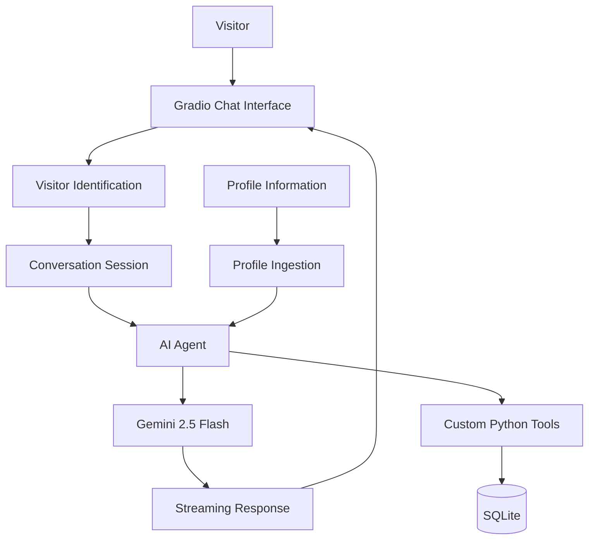

# AI-Powered Personal Digital Twin 🤖

What if you could have an AI version of yourself that people could talk to when you're not around?

That's the idea behind this project.

I built a Personal Digital Twin that allows visitors to interact with an AI-powered version of my professional profile. They can ask questions about my background, skills, projects, and experience, and the chatbot responds using the information provided to it.

The application uses **Google Gemini 2.5 Flash** for generating responses and the **OpenAI Agents SDK** to build the agent workflow.

## What can it do?

- **Answer questions about my profile:** The chatbot uses my professional information to answer questions about my experience, skills, and projects.
- **Use custom tools:** The agent can call custom Python functions when a task requires an action.
- **Remember conversations:** SQLite-backed sessions help maintain context during conversations.
- **Identify visitors:** Each visitor gets a unique ID and their own conversation session.
- **Stream responses:** Instead of waiting for the entire response, visitors can see it appear as it's generated.
- **Available online:** The application is deployed on Render, so visitors can interact with it through a web interface.


## Tech Stack

- **Language:** Python
- **LLM:** Google Gemini 2.5 Flash
- **Agent Framework:** OpenAI Agents SDK
- **Frontend:** Gradio
- **Database:** SQLite
- **Deployment:** Render
- **Dependency Management:** uv

## How does it work?

Here's the basic flow:



When someone opens the chatbot, the application identifies the visitor and creates a conversation session.

The agent then uses the available profile information and conversation context to understand the question. Gemini generates the response, and the agent can use custom tools when required.

Finally, the response is streamed back to the visitor through the Gradio interface.

## Project Structure

```text
digital-twin/
│
├── app.py                  # Gradio interface
├── main.py                 # Agent and conversation logic
├── ingestion.py            # Loading profile information
├── tools.py                # Custom function tools
│
├── twin/
│   ├── linkedin.pdf        # Profile document (private)
│   └── summary.txt         # Professional summary (private)
│
├── src/
│   └── digital_twin/
│       └── __init__.py
│
├── pyproject.toml
├── uv.lock
├── .gitignore
└── README.md
```

## Getting Started

Want to run the project locally? Follow these steps.

### 1. Clone the repository

```bash
git clone <YOUR_GITHUB_REPOSITORY_URL>
cd digital-twin
```

### 2. Install dependencies

I use `uv` to manage the Python environment and dependencies.

Install uv using the [official guide](https://docs.astral.sh/uv/getting-started/installation/).

Then run:

```bash
uv sync --frozen
```

### 3. Set up environment variables

Create a `.env` file in the project root and add the API credentials required by the application.

```env
# Add your Gemini API key
# Add your tracing API key if tracing is enabled
```

Use the exact variable names expected by the application. Keep this file private and never push it to GitHub.

### 4. Add profile information

Add your own profile documents to the `twin/` directory and make sure the ingestion module points to the correct files.

For public demonstrations, use sample or anonymized profile information rather than private documents.

### 5. Run the application

```bash
uv run python app.py
```

Open the local URL shown in your terminal, and you're ready to chat with your Digital Twin!

## Deployment

The application is deployed on **Render**.

The deployment commands are:

**Build command**
```bash
uv sync --frozen
```

**Start command**
```bash
uv run python app.py
```

The required API credentials are configured through Render's environment variables.

*Note: The current application uses SQLite. Render's default filesystem is ephemeral, so database changes may be lost after a restart or redeployment. Persistent storage needs to be configured separately.*

## What's next?

There are a few things I'd like to add as the project evolves:

- A live chat option so visitors can connect with me directly.
- A private dashboard to view visitor conversations.
- More robust database storage.
- Better evaluation of response accuracy and relevance.

## What I learned

Building this project gave me hands-on experience with LLM integration, agent workflows, custom function tools, conversation management, streaming responses, and deploying an AI application.

More importantly, it helped me understand how to move beyond a simple LLM chatbot and build an application where an agent can interact with tools and maintain conversational context.

---

**Built with Python, Gemini, and the OpenAI Agents SDK.**
